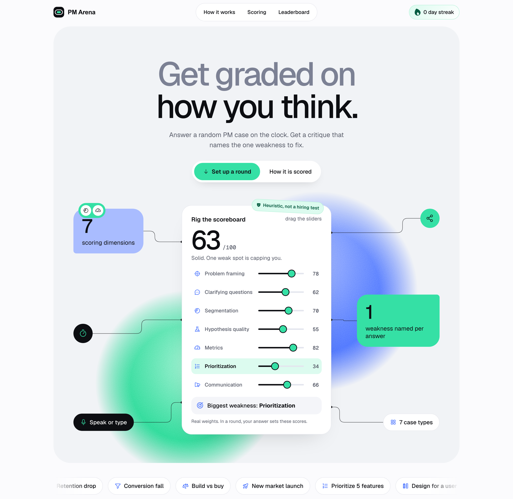

# PM Arena

[](https://github.com/batool-fariha/pm-arena/actions/workflows/test.yml)
[](LICENSE)

**Practice product management interview cases against the clock, by voice or text, and get a structured critique that names the single biggest weakness in your answer.**

**Live:** https://pm-arena-phi.vercel.app

[](https://pm-arena-phi.vercel.app)

> **Scores are heuristic assessments of how a written answer matches common PM-answer patterns (structure, keywords, specificity). They are not hiring assessments and do not predict interview outcomes.**

## Contents

- [Features](#features)
- [How a round works](#how-a-round-works)
- [How scoring works](#how-scoring-works)
- [Privacy at a glance](#privacy-at-a-glance)
- [Quick start](#quick-start)
- [Configuration](#configuration)
- [Project structure](#project-structure)
- [Documentation](#documentation)
- [Development](#development)
- [Status and roadmap](#status-and-roadmap)
- [License](#license)

## Features

- **Seven case types:** retention drop, conversion fall, build vs buy, new market launch, prioritize five features, design for a specific user, and define success metrics. Cases are generated with random parameters, so rounds differ.
- **Timed rounds:** 5, 10 or 15 minutes, typed or dictated. When time runs out, what you have is submitted.
- **A critique that points at one thing:** seven scores, what was found and missed in each, a fix written for that case, and the biggest weakness.
- **Follow-up questions** an interviewer could ask about your three weakest areas.
- **Drills:** a 3-minute round on one dimension, with a checklist of what the scorer looks for.
- **Progress on your device:** score trend, average per dimension, recent rounds with your answers, and a daily streak.
- **Optional, opt-in extras:** a shared leaderboard, and AI coach notes that quote what you wrote.

## How a round works

1. **Set up.** Choose a time limit and a case type (or leave it random) and press **Start round**.
2. **Answer.** Section starters (Questions, Segments, Hypothesis, Metrics, Recommend) drop a scaffold into the answer box.
3. **Review.** Open each dimension to see what was detected and missing, then work through the follow-up questions out loud.

New to it? Read the [user guide](docs/user-guide.md).

## How scoring works

Seven dimensions, each scored 0 to 100 and combined by weight:

| Dimension | Weight | Dimension | Weight |
|---|---|---|---|
| Hypothesis quality | 20 | Metrics | 15 |
| Problem framing | 15 | Prioritization | 15 |
| Segmentation | 15 | Clarifying questions | 10 |
| | | Communication | 10 |

The **biggest weakness** is the dimension with the largest weighted shortfall, `weight x (100 - score)`. Each dimension is a small rubric of signals found in the text, with guards against very short, repetitive and off-topic answers.

This is keyword and structure matching. It cannot judge whether an idea is good, and a keyword-heavy answer can still score well. Use the critique, not the number. Every signal, weight and guard is in the [scoring rubric](docs/scoring.md).

## Privacy at a glance

Everything runs in your browser except the features below, each of which you start yourself.

| Feature | What leaves your device | Where it goes | Stored? |
|---|---|---|---|
| Playing, scoring, history, streak, drills | Nothing | n/a | Only in your browser (`localStorage`) |
| Voice dictation | Audio | Your browser's speech service (Google for Chrome and Edge, Apple for Safari) | Not by this app |
| Post my score | Name, answer text, case | This app's server | Name, score, case type, time. **Not the answer** |
| AI coach notes | Answer text, case | This app's server, then the Anthropic API | Nothing is stored by this app |

The page loads the Geist font from Google Fonts and the Phosphor icons from unpkg. To rate-limit, the server keeps a truncated hash of your IP address for a short time. There are no accounts, cookies or analytics. Full detail, retention and how to request removal: [docs/privacy.md](docs/privacy.md).

## Quick start

```bash
git clone https://github.com/batool-fariha/pm-arena.git
cd pm-arena
python3 -m http.server 8000
```

Open http://localhost:8000. Use `localhost` or https, because the microphone needs a secure context. With only the static server the game works fully, the shared board shows as unavailable, and the AI coach button stays hidden. To run the API or deploy your own copy, see [docs/deploying.md](docs/deploying.md).

## Configuration

All optional. Set them as Vercel environment variables.

| Variable | Default | Purpose |
|---|---|---|
| `BLOB_READ_WRITE_TOKEN` | set by Vercel when a Blob store is linked | Storage for the shared leaderboard and AI usage counters |
| `ANTHROPIC_API_KEY` | unset | Enables AI coach notes. Without it the button is hidden |
| `ANTHROPIC_MODEL` | `claude-sonnet-5-5` | Model used for coach notes |
| `AI_DAILY_PER_CLIENT` | `8` | Coach-note requests per visitor per day |
| `AI_DAILY_GLOBAL` | `400` | Coach-note requests per day across all visitors |
| `LB_PATH` | `leaderboard.json` | Blob file name for the leaderboard (useful for tests) |

## Project structure

```
index.html          markup, styles and the app (home, case, result, drill views)
engine.js           case generator and scoring engine (runs in browser and Node)
api/scores.js       shared leaderboard function
api/grade.js        AI coach notes function
test/               unit, calibration and documentation tests
docs/               guides and reference
vercel.json         function settings
```

## Documentation

| | |
|---|---|
| [User guide](docs/user-guide.md) | Playing well, reading results, drills, dictation, troubleshooting |
| [Scoring rubric](docs/scoring.md) | How every dimension is scored, the guards and the limits |
| [Architecture and API](docs/architecture.md) | Components, endpoints, stored data, security model |
| [Design decisions](docs/decisions.md) | Why it is built this way and the trade-offs |
| [Privacy](docs/privacy.md) | What is stored, where it goes, how to remove it |
| [Deploying](docs/deploying.md) | Run the API locally or deploy your own copy |
| [Device test checklist](docs/device-checklist.md) | Verify a release on real phones and browsers |
| [Changelog](CHANGELOG.md) | What changed and when |

## Development

```bash
npm install
npm test
```

The suite covers the scoring engine, a calibration suite that catches drift in the heuristics, validation of AI coach replies, and a check that every documentation link resolves. CI runs it on every push. See [CONTRIBUTING.md](CONTRIBUTING.md) for adding case types and scoring signals, [SECURITY.md](SECURITY.md) to report a vulnerability, and the [Code of Conduct](CODE_OF_CONDUCT.md).

## Status and roadmap

Actively maintained as a personal project. Ideas, not promises: more case types, spaced repetition of your weakest dimension, and a sign-in so the AI coach can be limited per person instead of per device.

## License

[MIT](LICENSE). Designed and built by [Fariha Batool](https://www.linkedin.com/in/fariha-batool/).
