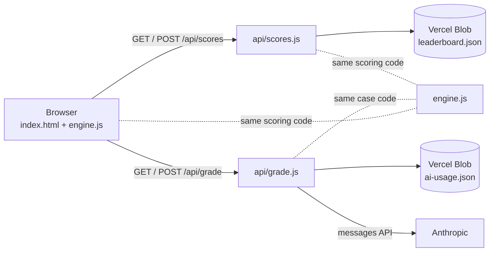

# Architecture and API

PM Arena is a static page plus two small serverless functions. There is no framework and no build step.



## Components

| Part | Role |
|---|---|
| `index.html` | The whole front end: home, case and result views, styles, voice dictation, history, share image. State is kept in memory and in `localStorage` |
| `engine.js` | Case generation and scoring. Runs in the browser and in Node, so the server can re-score exactly what the browser scored |
| `api/scores.js` | Shared leaderboard |
| `api/grade.js` | Optional AI coach notes |

## Browser storage

Stored under the `pmarena.v1` key in `localStorage`:

| Field | Meaning |
|---|---|
| `nick`, `limit`, `type` | Your last name, time limit and case type |
| `lastDay`, `streak`, `bestStreak`, `played` | Streak and counters |
| `board` | Your top 50 scores on this device |
| `history` | Your last 30 scored rounds: time, scores per dimension, weakest dimension, case, and your answer (up to 6000 characters) |

Clearing history on the home page empties `history`. Clearing site data removes everything.

## Shared leaderboard: `/api/scores`

### `GET /api/scores`

Returns the top entries, cached at the edge for 10 seconds.

```json
{
  "all":  [{ "nick": "Sam", "score": 82, "type": "New market launch", "ts": 1791747049584 }],
  "week": [{ "nick": "Sam", "score": 82, "type": "New market launch", "ts": 1791747049584 }]
}
```

Up to 50 entries each, sorted by score, then earliest first.

### `POST /api/scores`

```json
{
  "nick": "Sam",
  "answer": "the full answer text",
  "case": { "type": "launch", "title": "Launch in Poland", "prompt": "...", "list": [] }
}
```

The server rebuilds the case from `type`, `title`, `prompt` and `list`, **re-scores the answer with the same `engine.js`**, and ignores any score the client might send.

Success: `200 { "ok": true, "score": 76, "rank": 3, "nick": "Sam", "ts": 1791747049584 }`. `rank` is the position among stored entries with a strictly higher score, plus one, so ties share a rank.

| Status | `error` | Meaning |
|---|---|---|
| 400 | `bad_request`, `answer_too_long`, `bad_case`, `answer_too_short` | Invalid input. Answers need at least 30 words and at most 8000 characters |
| 405 | `method_not_allowed` | Only GET and POST |
| 429 | `slow_down` | Same client posted within 20 seconds |
| 503 | `busy` | Four write attempts collided; retry |
| 500 | `unavailable` | Storage or unexpected error |

Names are normalised, stripped to letters, digits, spaces and `. _ -`, and cut to 20 characters. An empty name becomes "Anonymous".

### Stored data

One private Blob file, `leaderboard.json`:

```json
{
  "entries": [{ "id": "a1b2c3d4", "nick": "Sam", "score": 82, "type": "New market launch", "ts": 1791747049584 }],
  "seen": { "3f9c0a1b2c4d5e6f": 1791747049584 }
}
```

- `entries` hold the name, score, case type and time. **The answer text is never written.**
- `seen` maps a truncated SHA-256 hash of the client IP (with a fixed salt) to its last post time, used for the 20-second limit, and entries older than 10 minutes are pruned.
- The file is trimmed on each write to the top 100 scores of all time plus up to 200 from the last 7 days.
- Writes use the blob's ETag with `ifMatch`, and retry up to four times when two writes collide.

## AI coach notes: `/api/grade`

### `GET /api/grade`

`{ "enabled": true }` when `ANTHROPIC_API_KEY` is set, otherwise `{ "enabled": false }`. The page hides the button when disabled.

### `POST /api/grade`

Same body as `/api/scores` (without `nick`). The function:

1. Validates the case and answer, and rebuilds the case server-side.
2. Counts the request against a per-client and a global daily cap (`ai-usage.json`, keyed by a truncated IP hash and the UTC date).
3. Calls the Anthropic Messages API with the answer as untrusted data and a **forced tool call**, so the reply is structured JSON.
4. Validates the reply: dimensions must be known, duplicates are dropped, strings are length-capped, and **every quote is checked to appear in the answer verbatim** (otherwise it is blanked).

Success: `200 { "ok": true, "notes": { "summary", "biggest_weakness": { "dimension", "why", "evidence_quote", "fix" }, "dimension_notes": [{ "dimension", "note", "quote" }], "stronger_sentence", "follow_up_questions": [] } }`. There is **no numeric score**; the heuristic score remains the only score.

| Status | `error` | Meaning |
|---|---|---|
| 400 | `bad_request`, `answer_too_long`, `bad_case`, `answer_too_short` | Invalid input |
| 429 | `limit` | Daily cap reached |
| 502 | `upstream`, `bad_reply` | Anthropic failed, or its reply failed validation |
| 503 | `not_configured` | No API key set |
| 500 | `unavailable` | Unexpected error |

The function allows up to 60 seconds (`vercel.json`) and aborts the upstream call at 50.

## Security model

- **Scores cannot be forged.** The server never reads a client score; it recomputes it. A client can still tune an answer, case text included, to game the heuristics, which is why the board is for practice.
- **Prompt injection.** The answer sits inside tags, the system prompt tells the model to ignore instructions in it, the reply must come through one tool call, and the output is validated and length-capped. The notes are advisory text, never executed or trusted for anything else.
- **Cost control.** The AI endpoint is off without a key, capped per client and globally, and you should also set a monthly spend limit with your provider.
- **Secrets.** Keys live only in Vercel environment variables. `.env*` is ignored by git.
- **Rendering.** Names and answers are HTML-escaped before display.
